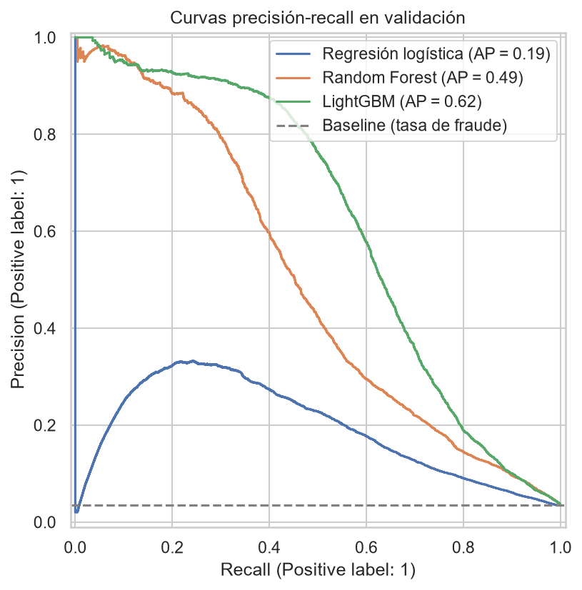
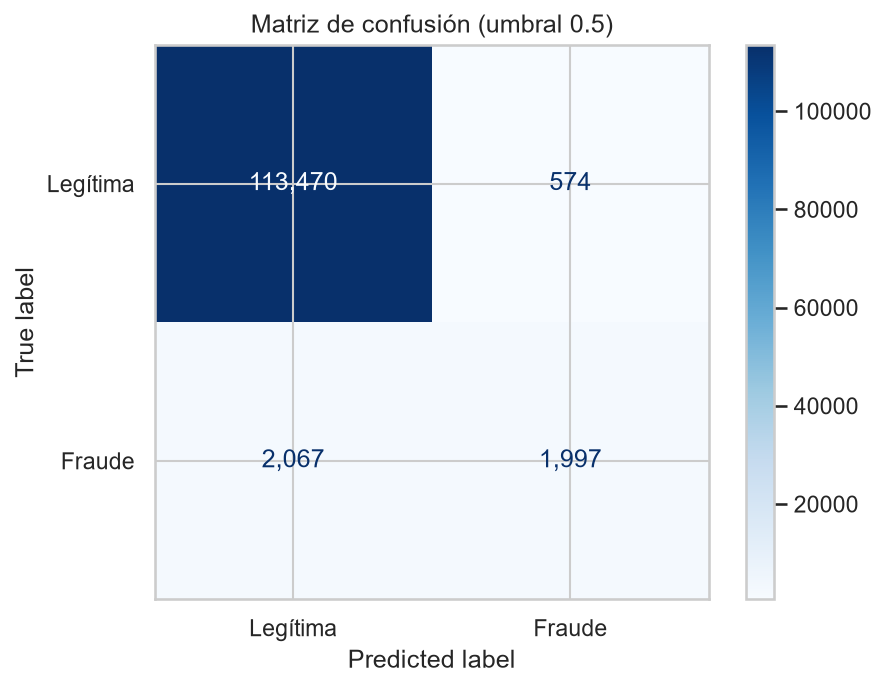
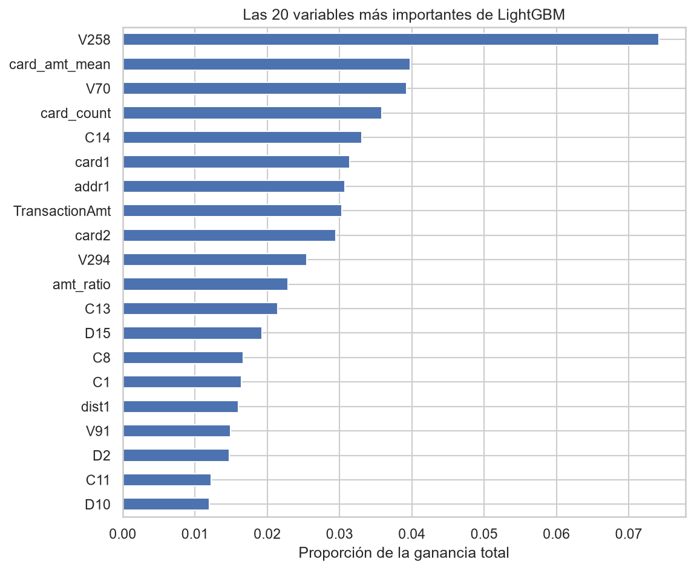

# Credit Card Fraud Detection

Proyecto de machine learning para detectar pagos fraudulentos con tarjeta en comercio online, usando datos reales de la competición [IEEE-CIS Fraud Detection](https://www.kaggle.com/competitions/ieee-fraud-detection) (Kaggle, 2019).

> **Estado del proyecto:** Terminado

## El problema

Cuando una tarjeta se pierde, se roba o se clona, puede usarse para compras online que su titular nunca hizo. Un sistema de detección de fraude tiene que equilibrar dos errores que cuestan dinero:

- **Fraude que se escapa (falso negativo):** el pago se aprueba y se pierde el importe entero.
- **Cliente molestado (falso positivo):** se bloquea una compra legítima, y el cliente puede enfadarse e irse a otro banco.

Mi objetivo era construir un modelo que estime la probabilidad de fraude de cada transacción y elegir después un umbral de decisión que equilibre esos dos errores.

## Los datos

Datos de Vesta Corporation, repartidos en dos tablas unidas por `TransactionID`:

| Tabla | Filas | Columnas | Contenido |
|---|---|---|---|
| `train_transaction` | 590.540 | 394 | Importe, tarjeta, dirección, email y variables anonimizadas. Incluye el target `isFraud` |
| `train_identity` | 144.233 | 41 | Dispositivo y conexión, en su mayoría anonimizados |

Los datos no están en el repositorio por su tamaño y licencia. Para reproducir el proyecto, hay que descargarlos de la [página de la competición](https://www.kaggle.com/competitions/ieee-fraud-detection/data) y descomprimirlos en `data/raw/`.

## Resultados

Comparé cuatro modelos con validación temporal: entrenando con el 80% más antiguo de las transacciones y evaluando con el 20% más reciente.

| Modelo | PR-AUC | ROC-AUC |
|---|---|---|
| Baseline (`DummyClassifier`) | 0,034 | 0,500 |
| Regresión logística | 0,190 | 0,835 |
| Random Forest | 0,493 | 0,903 |
| **LightGBM** | **0,611** | **0,917** |



Uso la **PR-AUC** como métrica principal porque solo el 3,5% de las transacciones son fraude: la accuracy no sirve (un modelo que nunca detecta fraude tiene un 96,5%) y la ROC-AUC sale demasiado optimista con clases tan desbalanceadas.

**LightGBM es el mejor modelo.** La regresión logística se queda muy lejos porque, al ser lineal, no capta las relaciones no lineales que hay en los datos, como la forma de U del importe o el pico de fraude en la madrugada. Los árboles sí las captan, y LightGBM mejora a Random Forest en un 24% porque cada árbol se centra en corregir los errores de los anteriores.

### Umbral de decisión y coste

El modelo da una probabilidad, pero un banco tiene que decidir si aprueba o bloquea. Elegí el umbral con una función de coste en euros: el fraude que se escapa se pierde entero, y bloquear una compra legítima cuesta una parte `p` de su importe (la molestia al cliente, la venta perdida y el riesgo de que se vaya). Ese `p` es una suposición mía, porque no tengo el dato real, pero un analista de riesgos del banco lo podría dar. Comprobé cómo cambia el umbral óptimo con distintos valores de `p`.

Con el umbral elegido (0,5), en el periodo de validación:

- Se detectan **2.102 fraudes** (el 52%).
- Se molesta a **827 clientes legítimos**, unos 0,4 por cada fraude detectado.
- Las pérdidas estimadas pasan de **609.934 €** sin modelo a **368.137 €**: una reducción del **40%**.



### Qué variables han servido

Las variables más útiles para el modelo son las que creé en el feature engineering comparando cada transacción con el comportamiento de su tarjeta: el importe medio de la tarjeta (`card_amt_mean`) y su número de transacciones (`card_count`) están entre las cuatro más importantes de más de 500 columnas. También aportan la hora y los céntimos del importe. En cambio, los indicadores de nulos y el índice de riesgo compuesto aportan poco a LightGBM, porque ya trata los nulos y aprende las combinaciones por sí solo.



## Qué hice en cada fase

**1. Análisis exploratorio** ([`01_EDA.ipynb`](notebooks/01_EDA.ipynb))

- Solo el 3,5% de las transacciones son fraude, así que la accuracy no sirve como métrica.
- Los nulos aportan información: las transacciones sin dirección tienen cerca de un 12% de fraude, y las que tienen datos de identidad, un 7,8% frente al 2,1% de las que no.
- Ninguna variable explica el fraude por sí sola (la mayor correlación con el target es de 0,15), y hay relaciones no lineales que la correlación de Pearson no detecta.
- El fraude cambia con el tiempo y el test es posterior, así que la validación tenía que ser temporal.

**2. Feature engineering** ([`02_feature_engineering.ipynb`](notebooks/02_feature_engineering.ipynb))

- Agrupé las variables de dispositivo, navegador, sistema operativo y email en familias, y junté las categorías con pocas transacciones en `other`.
- Creé variables de tiempo (hora y día de la semana), los céntimos del importe, agregados por tarjeta y un índice de riesgo compuesto.
- Todo lo que aprende de los datos (qué categorías son raras y los agregados por tarjeta) lo calculé solo con el periodo de entrenamiento, para evitar data leakage.

**3. Modelado** ([`03_modeling.ipynb`](notebooks/03_modeling.ipynb))

- Comparé cuatro modelos de menos a más complejos, con early stopping en LightGBM.
- Elegí el umbral de decisión con una función de coste y un análisis de sensibilidad.
- Analicé la importancia de las variables para comprobar qué había aportado el feature engineering.

## Limitaciones

- Con el umbral elegido se escapa casi la mitad del fraude, y sobre todo el de mayor importe: por número detecto el 52%, pero por importe solo el 44%.
- Usé el periodo de validación para el early stopping y para elegir el umbral, así que los resultados son ligeramente optimistas.
- El ahorro depende del coste supuesto de bloquear a un cliente legítimo.

## Próximos pasos

- Crear un identificador de cliente combinando `card1`, `addr1` y `D1`, como hicieron los ganadores de la competición, para comparar cada transacción con el comportamiento del cliente y no solo de la tarjeta.
- Usar SHAP para explicar por qué el modelo marca cada transacción concreta como sospechosa.

## Estructura del repositorio

```
credit-fraud-detection/
├── data/
│   ├── raw/              # CSV originales de Kaggle (no incluidos)
│   └── processed/        # Datos en Parquet generados por los notebooks
├── notebooks/
│   ├── 01_EDA.ipynb                  # Análisis exploratorio y limpieza
│   ├── 02_feature_engineering.ipynb  # Creación de variables y codificación
│   └── 03_modeling.ipynb             # Modelos, umbral y conclusiones
├── outputs/figures/      # Gráficos
├── requirements.txt
└── README.md
```

## Cómo reproducirlo

Requisitos: Python 3.11.

```bash
git clone https://github.com/pablofranb/credit-fraud-detection.git
cd credit-fraud-detection
python -m venv venv
venv\Scripts\activate          # En Linux/Mac: source venv/bin/activate
pip install -r requirements.txt
```

Después, descarga los datos en `data/raw/` y ejecuta los notebooks en orden.

## Tecnologías

Python · pandas · NumPy · scikit-learn · LightGBM · Matplotlib · Seaborn · Jupyter

## Autor

Pablo Franco · [GitHub](https://github.com/pablofranb)
